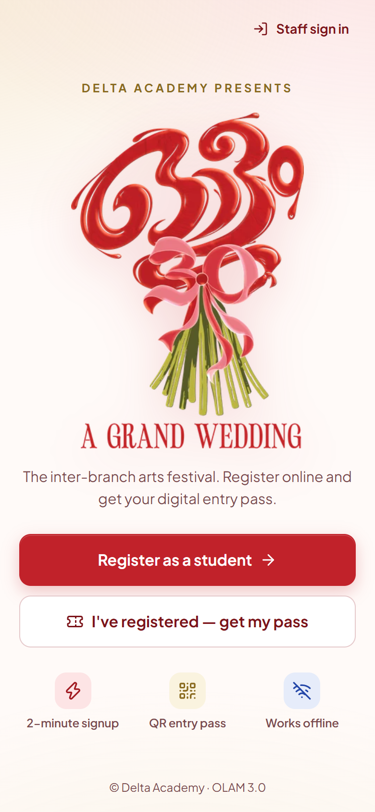
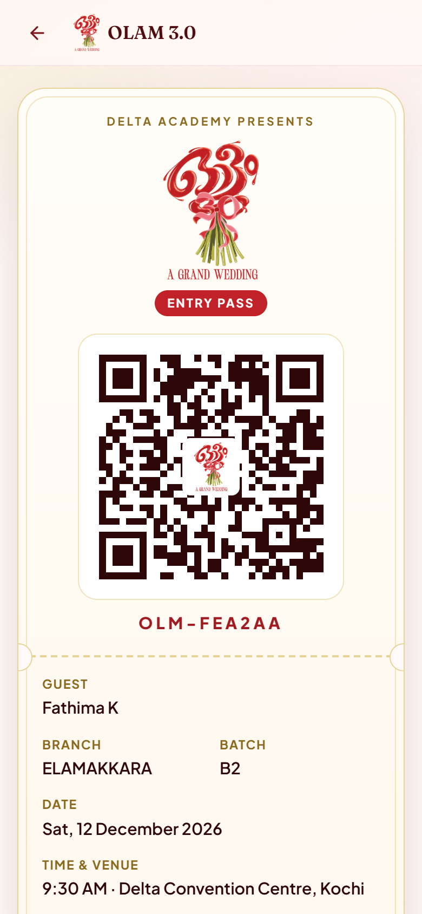
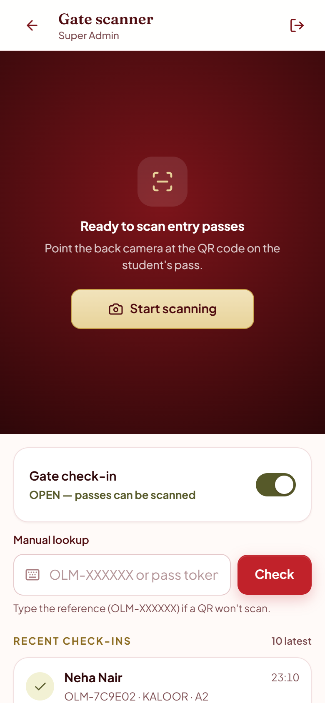
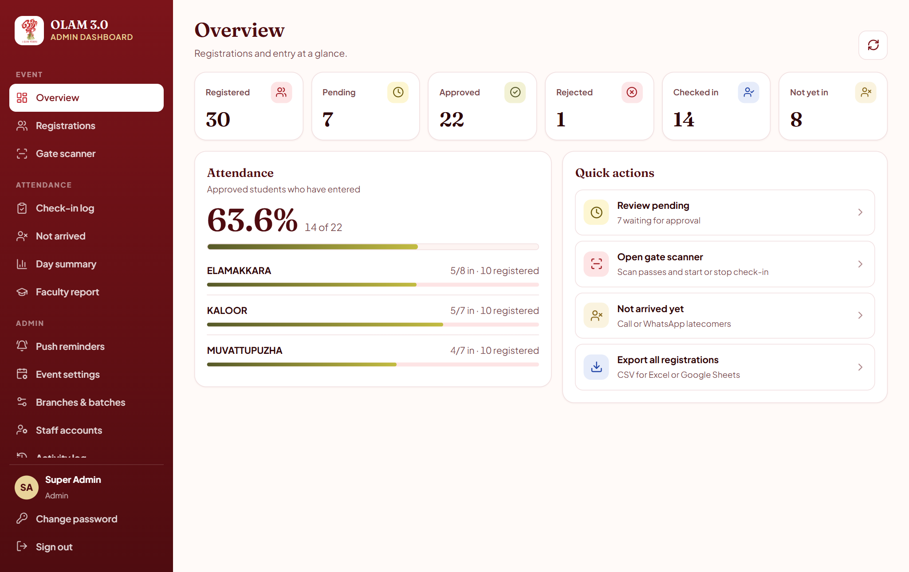
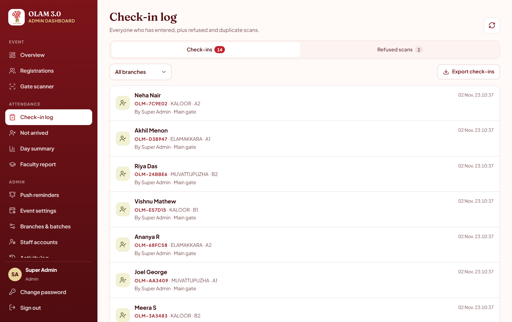

# OLAM 3.0 — Event Registration & Gate Check-in

Registration, QR entry passes and gate check-in for **OLAM 3.0 – A Grand Wedding** (Delta Academy).

Students register from their phone and get a QR pass once approved. Gate staff scan the passes at the venue,
and coordinators and admins follow everything live. It all runs as one Cloudflare Worker with a D1 database.
The app is an installable PWA that also works offline at the venue.

**Live:** https://olam3-0.petryxion.com

<p align="center">
  
  &nbsp;
  
  &nbsp;
  
</p>

<p align="center">
  
</p>

<details>
<summary>More screenshots</summary>
<br>
<p align="center">
  
</p>
</details>

<sub>Screenshots use made-up demo data.</sub>

---

## Contents

- [Features](#features)
- [Tech stack](#tech-stack)
- [Getting started (local)](#getting-started-local)
- [Deploying](#deploying)
- [Database & migrations](#database--migrations)
- [Scripts](#scripts)
- [Project structure](#project-structure)
- [API overview](#api-overview)
- [Security](#security)
- [Installing on phones](#installing-on-phones)

---

## Features

### Students
- Register once (one registration per email and per mobile number).
- The phone they registered on opens straight to their status or QR pass. **Not you?** clears it.
- On another phone, they get their pass back with **email + mobile number**.
- Download the pass as a **PDF** or share it **as an image** (for example to WhatsApp).
- The saved pass opens **offline** at the venue, even when the browser blocks storage.
- Optional **push reminders** (on iPhone, after Add to Home Screen, iOS 16.4+).

### Coordinators (own branch only)
- Approve, bulk-approve, or reject with a reason.
- See the check-in log and refused scans, the faculty report, the event-day summary, and the *not arrived yet* list with call and WhatsApp buttons.
- Export CSVs when an admin allows it. Exports follow the current filters.

### Gate scanners
- Camera QR scanning with a sound and vibration for each result, plus manual `OLM-XXXXXX` lookup.
- Scanning a pass twice can't check someone in twice, and recent check-ins are listed.
- Scanning only works while a super admin has **check-in open**.

### Super admins
Everything above for all branches, plus:
- Open or close **registration**, and switch **gate check-in** on or off.
- Edit the event date and venue (both printed on passes), the privacy notice and the "registration closed" message.
- Manage **branches** (add, rename, switch off) and **batches** (add, rename, reorder, delete).
- Manage **staff accounts**: create, set CSV permission, deactivate, reset password, delete. The activity log keeps the names of deleted staff.
- Delete registrations, one at a time or in bulk. This also removes the pass, check-in and push devices.
- Send **push reminders** to a chosen audience and branch.
- Read the **activity log**.

## Tech stack

| Layer | Tech |
|---|---|
| Frontend | React 19, Vite, React Router, `vite-plugin-pwa` (service worker, offline cache, manifest) |
| API | Cloudflare Worker + [Hono](https://hono.dev), every route under `/api/*` |
| Validation | zod 4 |
| Database | Cloudflare D1 (`olam3-db`, SQLite) |
| Hosting | Workers Static Assets: one Worker serves the app **and** the API from the same domain |
| QR & passes | `qrcode` (error correction H, logo in the centre), `qr-scanner` (gate camera), `jspdf` (PDF pass) |
| Push | Web Push with VAPID + aes128gcm on WebCrypto (`worker/lib/webpush.ts`, no extra library) |
| UI | Plain CSS with design tokens, `lucide-react` icons, self-hosted Fraunces + Plus Jakarta Sans fonts |

The app sends no email. Students download their pass or get it back with their email and mobile number, and reminders go out as push notifications.

## Getting started (local)

Requires **Node 20+**.

```bash
npm install
cp .dev.vars.example .dev.vars        # local secrets (never commit .dev.vars)
npm run vapid -- --print              # optional: paste the two VAPID lines into .dev.vars for push
npm run db:migrate:local              # create the local D1 database
npm run dev                           # build + wrangler dev → http://127.0.0.1:8787
```

Then open `http://127.0.0.1:8787/staff/login`, choose **Admin**, and sign in with `INITIAL_ADMIN_EMAIL`
and `INITIAL_ADMIN_PASSWORD` from `.dev.vars` (`admin@example.com` / `Bootstrap123` in the example file). You'll be asked to set a new password.

For frontend work with hot reload, keep `npm run dev` running and start `npm run dev:ui` in a second terminal.
It serves the app on `:5173` and forwards `/api` to `:8787`.

### Tests

With `npm run dev` running:

```bash
npm run test:api     # end-to-end API tests (node --test) against :8787
npm run typecheck    # app + worker
```

## Deploying

```bash
npx wrangler login     # once
npm run deploy         # vite build && wrangler deploy
```

First deploy only:

```bash
npm run secrets        # asks for the main admin email + password, generates JWT_SECRET
npm run vapid          # VAPID key pair for push reminders, stored as Worker secrets
```

> Changing `JWT_SECRET` signs everyone out **and invalidates every issued QR pass**.
> To change only the main admin email or password, use `npm run secrets -- --keep-jwt`.

### Configuration

| Name | Kind | Purpose |
|---|---|---|
| `INITIAL_ADMIN_EMAIL` | secret | The first super admin, created on its first sign-in |
| `JWT_ISSUER` | var | JWT issuer claim |
| `JWT_SECRET` | secret | Signs staff sessions and derives QR pass tokens |
| `INITIAL_ADMIN_PASSWORD` | secret | Bootstrap password for `INITIAL_ADMIN_EMAIL` (must be changed at first sign-in) |
| `VAPID_PUBLIC_KEY` / `VAPID_PRIVATE_KEY` | secrets | Web Push keys |

The Worker serves the custom domain `olam3-0.petryxion.com` (`routes` in `wrangler.jsonc`) as well as `*.workers.dev`.

## Database & migrations

The schema lives in `migrations/`, applied in order:

| File | Adds |
|---|---|
| `0001_init.sql` | Core schema + seed (branches, batches, settings) |
| `0002_push.sql` | `push_subscriptions` |
| `0003_deleted_staff.sql` | `deleted_users` (keeps names in the activity log after staff are deleted) |
| `0004_checkin_switch.sql` | `settings.checkin_open` (gate check-in starts **closed**) |

To change the schema, add `migrations/000N_<name>.sql`, then:

```bash
npm run db:migrate:local   # local
npm run db:migrate         # production — run before deploying code that needs it
```

To recreate the database from scratch: `npx wrangler d1 create olam3-db`, put the new `database_id` in `wrangler.jsonc`, then run `npm run db:migrate`.

## Scripts

| Script | What it does |
|---|---|
| `npm run dev` | Build the app, run `wrangler dev` on :8787 with local D1 |
| `npm run dev:ui` | Vite dev server with hot reload (forwards `/api` to :8787) |
| `npm run build` | Production build into `dist/` |
| `npm run typecheck` | TypeScript check for app + worker |
| `npm run test:api` | End-to-end API tests against :8787 |
| `npm run db:migrate:local` / `db:migrate` | Apply D1 migrations locally / remotely |
| `npm run secrets` | Upload `JWT_SECRET` + `INITIAL_ADMIN_PASSWORD` |
| `npm run vapid` | Generate VAPID keys and upload them (`-- --print` to print them for `.dev.vars` instead) |
| `npm run deploy` | Build and deploy the Worker |

## Project structure

```
worker/                  Cloudflare Worker (Hono API)
  index.ts               app setup, error handling, route mounting
  lib/ctx.ts             auth middleware, roles, branch scoping, settings, audit
  lib/util.ts            PBKDF2, HMAC pass tokens, CSV, rate limiting, fail()/readBody()
  lib/webpush.ts         VAPID JWT + RFC 8291 payload encryption
  routes/                auth, registrations, scan, reports, push, admin
src/                     React PWA
  api.ts                 typed API client
  pages/                 student pages: Landing, Register, Confirmation, MyPass, Pass
  pages/staff/           Login, ChangePassword, Dashboard, Scanner, Manage, EventSettings,
                         Attendance, Absent, FacultyReport, EventSummary, AuditLog, Notifications
  components/            StaffShell, StudentScreen, QR pass card, editors, UI kit
  lib/pass.ts            saved pass + "me" on this device, QR with logo
  lib/pass-image.ts      ticket drawing (PDF + shared PNG)
  lib/pass-pdf.ts        PDF pass (the only place jsPDF is imported)
  lib/push.ts            push opt-in
  styles.css             all styles, design tokens on :root
public/                  icons, fonts, sounds, push-sw.js, _headers
migrations/              D1 schema
scripts/                 secrets + VAPID helpers
tests/api.test.mjs       end-to-end API tests
wrangler.jsonc           Worker, D1, assets and domain config
```

## API overview

Every error comes back as `{ "detail": "<message>" }`, and the app shows that message to the user as-is.

**Public**
- `GET /api/health`
- `GET /api/public/{branches,batches,settings}`
- `POST /api/registrations`: register
- `POST /api/registrations/lookup`: email + mobile (or email + reference)
- `POST /api/pass/verify`
- `GET /api/push/public-key`, `POST /api/push/{subscribe,unsubscribe}`

**Staff** (signed in; coordinators only ever see their own branch)
- `/api/auth/{login,me,change-password}`
- `GET /api/registrations`, `GET /api/registrations/:id`, `POST /api/registrations/:id/{approve,reject}`, `POST /api/registrations/bulk-approve`
- `GET /api/scan/status`, `POST /api/scan`, `GET /api/scan/history`: **scanners + super admins only**
- `GET /api/attendance`, `GET /api/stats`, `GET /api/reports/{faculty,event-day,absent}`
- `GET /api/export/{registrations,faculty,event-day,absent,attendance}.csv`
  (`registrations.csv?status=&branch_id=&q=`, `attendance.csv?view=checkins|attempts&branch_id=`)

**Super admin**
- `GET|PUT /api/settings`, `PUT /api/settings/checkin`
- `/api/branches` (GET, POST, PATCH `/:id`)
- `/api/batches` (GET, POST, PATCH `/:id`, PUT `/order`, DELETE `/:id`)
- `/api/staff` (GET, POST, PATCH `/:id`, DELETE `/:id`)
- `GET /api/audit`
- `DELETE /api/registrations/:id`, `POST /api/registrations/bulk-delete`
- `GET /api/push/stats`, `POST /api/push/send` (sends to 40 devices per call because of the free-plan request limit; the app pages through with `after`)

## Security

- Passwords hashed with PBKDF2. Bootstrap and admin-set passwords must be changed at first sign-in, and weak passwords are rejected.
- 8-hour JWT sessions. Per-IP rate limits and sign-in lockout. The public limits are loose enough for many students sharing the venue Wi-Fi.
- **QR passes:** token = HMAC(`JWT_SECRET`, `reg_id:version`). The token itself is never stored; only an HMAC of it is.
  Re-approving after a rejection bumps `version`, so old QR codes stop working.
- Branch scoping is enforced on the server, not just in the UI.
- CSV exports are protected against formula injection.
- Push endpoints are restricted to known push services.

## Installing on phones

- **Android (Chrome):** open the site and tap the install prompt on the landing page (or ⋮ → *Install app*).
- **iPhone (Safari):** Share → **Add to Home Screen**. The landing page shows these steps.

The camera scanner needs HTTPS, which the custom domain and `*.workers.dev` both provide.
